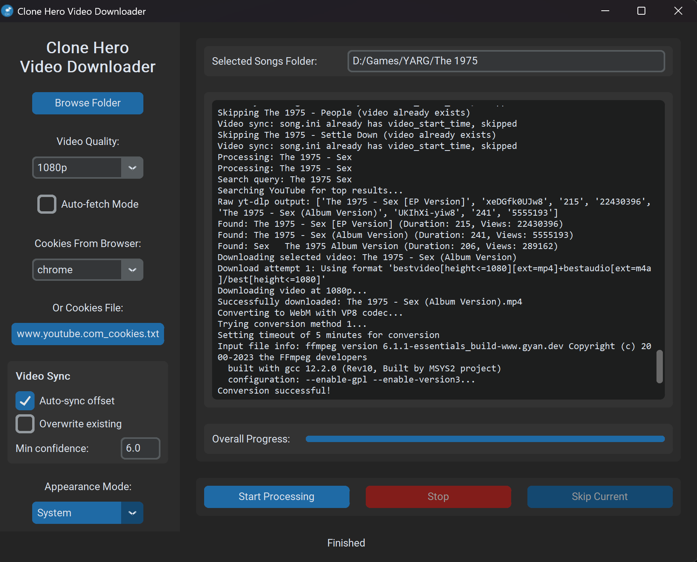

# Clone Hero Video Background Downloader

A Windows desktop application that automatically downloads background videos for Clone Hero (and YARG) songs from YouTube, converts them to the required `.webm` format with VP8 codec, and can set each video's sync offset automatically.



## Features

- Modern UI with light/dark theme support
- Select your Clone Hero Songs folder
- Auto-detects song folders without video.webm files
- Searches YouTube for each song using the folder name
- Shows top 3 video results for each song with option to choose
- Allows custom YouTube URL input for full control, including when the search finds nothing
- Downloads the video and converts to WebM format with VP8 codec (required by Clone Hero)
- Option to select video quality (360p, 480p, 720p, 1080p); encoding quality scales with it
- Vertical and ultra-wide videos are padded to 16:9 so the game shows the whole frame instead of cropping it
- Age-restricted videos via your browser's YouTube login (browser cookies or a cookies.txt file)
- Automatic video sync: works out `video_start_time` for each song so the video lines up with the chart audio
- Auto-fetch mode to automatically select the first result
- Skip or overwrite existing videos, with "Skip All" option

## Requirements

- Windows
- Python 3.10 or higher (for running from source)
- [Node.js](https://nodejs.org/) 22 or higher. yt-dlp needs a JavaScript runtime to solve YouTube's download challenges; without it only thumbnails are available
- yt-dlp with its default extras (`yt-dlp[default]`, for YouTube downloads)
- ffmpeg (for video conversion)
- customtkinter (for modern UI)
- numpy and scipy (optional, for automatic video sync)

## Quick Installation

For an easy setup, simply run the included setup script:

1. Install [Node.js](https://nodejs.org/) (22 or higher) if you don't have it. The setup script doesn't install it
2. Download or clone this repository
3. Double-click `setup.bat` to run the setup script
4. The script will:
   - Check your Python version
   - Install required Python packages
   - Download and install ffmpeg locally if needed
   - Prepare the run_downloader.bat file

After setup completes, you can run the application using `run_downloader.bat`.

## Using the Standalone Executable (No Python Required)

For users without Python installed:

1. Download the latest release from the [Releases](https://github.com/Shonitbar/CloneHeroVideoDownloader/releases) page
2. Extract the ZIP file
3. Run `CloneHeroVideoDownloader.exe`

The executable includes ffmpeg. Node.js must still be installed separately (see Requirements).

## Building the Standalone Executable

To build the standalone executable yourself:

1. Make sure you have Python installed
2. Run `build_standalone.bat`
3. The script will:
   - Download and embed ffmpeg
   - Install necessary dependencies
   - Build a standalone executable with PyInstaller
   - The executable will be placed in the `dist` folder

## Manual Installation

If you prefer to install dependencies manually:

1. Install Python 3.10 or higher from [python.org](https://www.python.org/downloads/) if you don't have it
2. Install Node.js 22 or higher from [nodejs.org](https://nodejs.org/)
3. Install the required Python packages:
   ```
   pip install -r requirements.txt
   ```
4. Install ffmpeg:
   - Download from [ffmpeg.org](https://ffmpeg.org/download.html)
   - Extract the files
   - Add the bin directory to your system PATH

## Usage

1. Run the application
2. Click "Browse Folder" and select your Clone Hero Songs folder
3. Choose your preferred video quality
4. Enable "Auto-fetch Mode" if you want to automatically use the first result
5. If you need age-restricted videos, set up cookies (see below)
6. Leave "Auto-sync offset" ticked to set each song's video sync automatically (see below)
7. Click "Start Processing"
8. The app will:
   - Check each song folder for an existing video.webm file
   - If no video exists, search YouTube, download, and convert
   - If the search finds nothing, ask for a YouTube URL (or skip the song)
   - If a video already exists, ask if you want to skip or overwrite
9. Monitor progress in the log window

## Age-Restricted Videos

YouTube only serves age-restricted videos to a logged-in account. The app can use your YouTube login from your browser in one of two ways:

- **Cookies From Browser:** pick your browser from the dropdown. This reads the browser's cookie store directly.
- **Or Cookies File:** export a `cookies.txt` file (Netscape format) with a browser extension such as "Get cookies.txt LOCALLY" while logged in to YouTube, then select it with "Browse...". A cookies file takes priority over the dropdown.

On Windows, current versions of Chrome encrypt their cookie store in a way yt-dlp can't read ("Failed to decrypt with DPAPI"), so with Chrome use a cookies file. Cookies expire, so re-export the file if age-restricted downloads start failing again.

A cookies file contains your YouTube login, so keep it private and don't commit or share it.

## Video Sync

Music videos often have an intro, or an outro, that the chart audio doesn't, so the video plays out of time with the song unless `song.ini` has a `video_start_time` value. With "Auto-sync offset" ticked, the app works this out after each download by matching the video's soundtrack against the chart audio, and writes it to `song.ini`. A backup of the original is saved as `song.ini.bak`. It also runs for songs you skip because they already have a video, so you can sync an existing library.

- **Overwrite existing:** by default, songs that already have a `video_start_time` are left alone. Tick this to recalculate them, for example after replacing a video.
- **Min confidence:** offsets are only written when the audio match is clearly better than any other alignment. Matches scoring below this threshold (default 6.0) are not written, and are listed at the end of the run for you to check by hand. Lower it if correct matches are being rejected; raise it if wrong offsets are being written.

The sync also works on its own from the command line, for example to process a folder of songs that already have videos:

```
python sync_video.py "C:\path\to\Songs" --apply
```

Without `--apply` it only prints what it would write. Use `--overwrite` to recalculate existing values and `--help` for all options.

## Notes

- The app uses the song folder name as the YouTube search query
- Downloaded videos are automatically converted to WebM with VP8 codec
- Temporary files are cleaned up after processing

## Troubleshooting

- If you get a "Missing dependencies" message, run the setup.bat file again
- Make sure ffmpeg is properly installed for video conversion
- Check the log for detailed error messages
- "Signature solving failed" or "Only images are available": install Node.js 22 or higher, and make sure yt-dlp was installed with `pip install -r requirements.txt` (which includes `yt-dlp[default]`)
- "This video is age-restricted": set up cookies (see Age-Restricted Videos)
- "Failed to decrypt with DPAPI": your browser's cookies can't be read directly; use a cookies file instead
- The Video Sync options are greyed out: install numpy and scipy (`pip install numpy scipy`)

## License

Released under MIT License. See LICENSE file for details. 
